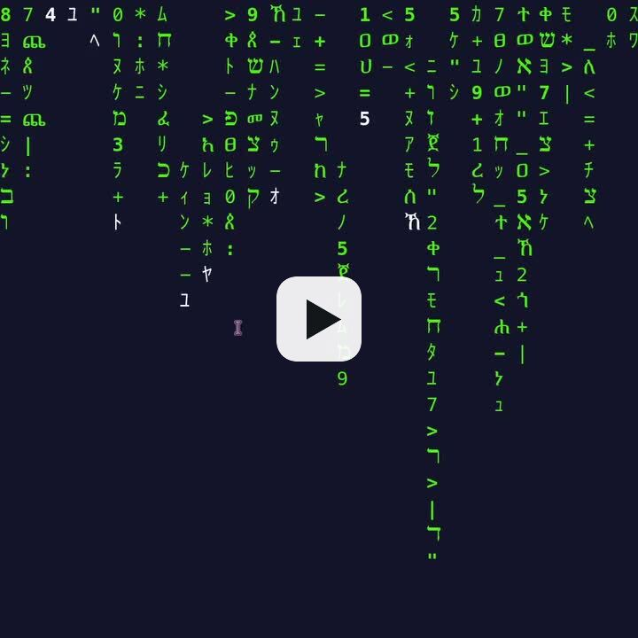
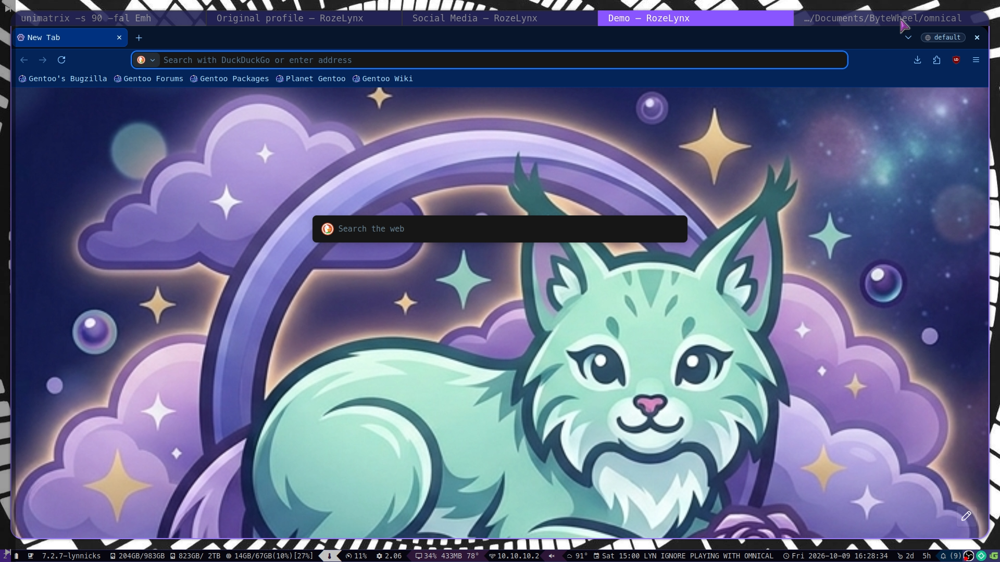
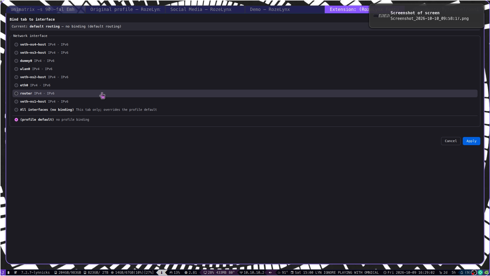
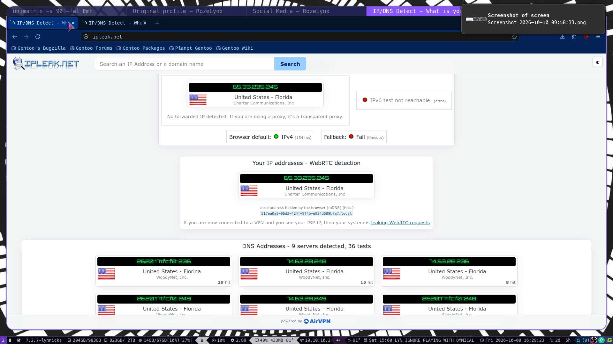
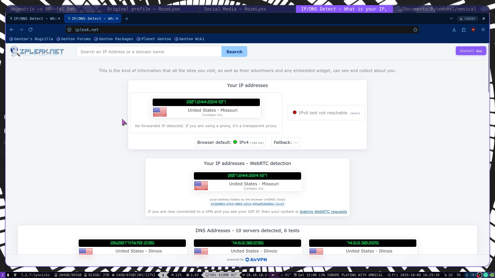

*For my wife, my inspiration. YAMS*

# CAUTION

Please do not use this browser in sensitive operations without being aware of the risks!

This software is provided as-is, without any warranty as expressed or implied.

# RozeLynx

Firefox fork, including Librewolf and Floorp patches, plus more.

Lynxes are stronger and more dangerous than foxes. RozeLynx is beautiful, but she must be treated with care.

<p align="center">
<a href="https://www.instagram.com/reel/DeSi2y-unz7/"></a>
<br>
<em>RozeLynx in action — <a href="https://www.instagram.com/reel/DeSi2y-unz7/">watch the demo reel</a> (sound on!).</em>
</p>

RozeLynx adds enhanced PWA support, modern download handoff support (well, sort of. Tested with uGet. Testers/PRs welcome!), and the pièce de résistance, per-tab network interface binding. No more redoing VPN split tunnel clients. You can set profile defaults for interfaces, and switch interface per tab on the fly. PLEASE BE CAREFUL. We made great pains preventing leaks, using DNS over HTTPS (DoH), but it is advised to treat this as alpha-stage software. We recommend users to run leak checks with tcpdump or Wireshark, before doing anything sensitive.

Linux only, for now. PRs welcome.

## Screenshots

<p align="center">

</p>

<p align="center">

</p>

<p align="center">

</p>

<p align="center">

</p>

## About this repository

This is the RozeLynx browser repository: the complete patch set that
turns Firefox into RozeLynx, plus the build machinery to apply it.
Development happens in the ByteWheel Gentoo overlay
(https://github.com/ByteWheel/gentoo-overlay); this repo is a
published mirror of its patch tree. Run `./sync-from-bytewheel.sh` to
refresh it after changes land in the overlay (or pass the overlay path
as an argument; `/var/db/repos/bytewheel` is picked up as a fallback).

Layout:

- `patches/` — LibreWolf-style privacy hardening patches and settings
  (top level: `*.patch`, `librewolf.cfg`, `local-settings.js`,
  `policies.json`, ...) plus `ui-patches/`, `root-patches/` (patches
  applied at the source-tree root) and the full `rozelynx/` tree:
  branding artwork, the net-iface and PWA/SSB taskbar C++ components,
  the RozeLynx Features extension source, the native messaging host,
  the mozconfig configure fragment, system prefs, the Lepton and SSB
  skins, and toolchain fixes
- `gentoo/firefox-template.ebuild` — the patched ebuild template the
  Gentoo build is regenerated from
- `rozelynx-distro-build.sh` + `rozelynx-distro-versions.conf` — the
  distro-agnostic build and its pinned sources
- `arch/` — AUR packages: `rozelynx-git` (full source build through the
  distro-agnostic script) and `rozelynx-bin` (the precompiled release
  tarballs), each with its generated `.SRCINFO`;
  `make-srcinfo.sh` regenerates it without makepkg
- `sync-from-bytewheel.sh` — the mirror refresh script
- `assets/` — the demo video, poster frame and screenshots embedded in this README

The LibreWolf patches here are vendored and rebased per Firefox
version (the pinned upstream LibreWolf checkout the build fetches is
reference only). Floorp features are ported into RozeLynx's own
extension and C++ code — nothing from the Floorp tree is applied as a
patch.

## Build instructions

There are two supported ways to build RozeLynx: the distro-agnostic
build script in this repo (works on any Linux distribution, packages
as tarball/AppImage/Flatpak/snap), and the original Gentoo ebuild in
the ByteWheel overlay (https://github.com/ByteWheel/gentoo-overlay).

### Requirements

Both builds need the usual Firefox toolchain: a C/C++ compiler (clang
is the default), Rust (the ebuild pins a minimum version, e.g. >= 1.90),
Python 3, Node.js, NASM on x86, and the usual system libraries
(nss/nspr/icu/harfbuzz/libevent/...). The RozeLynx branding is
generated at build time with **ImageMagick 7** (`magick`) - this is a
hard requirement, not optional: the build refuses to produce an
unbranded Firefox. Expect roughly 10-19 GB of disk and several hours
of compile time.

### Distro-agnostic (any Linux)

From the root of this repository:

```sh
# full build + all package formats:
./rozelynx-distro-build.sh all --appimage --flatpak --snap

# or step by step:
./rozelynx-distro-build.sh fetch prepare configure build install
./rozelynx-distro-build.sh package --tarball

# inspect/override the feature set (same names as the ebuild's USE flags):
./rozelynx-distro-build.sh --list-flags
./rozelynx-distro-build.sh --no-use net-iface --use pgo all --appimage
```

Notes:

- Everything is pinned in `rozelynx-distro-versions.conf`:
  the Firefox source tarball and checksums, the Gentoo firefox
  patchset, the LibreWolf and Floorp reference checkouts, the
  appimagetool release, the Flatpak runtime and the snap base.
- Feature flags match the Gentoo ebuild's USE flag names one-to-one
  (`--use`/`--no-use`, repeatable, comma-separated).
- Packaging: `--tarball` (a `usr/` tree for any distro with a
  new-enough glibc), `--appimage`, `--flatpak` (needs flatpak,
  flatpak-builder and the pinned runtime installed) and `--snap`
  (needs snapd). The net-iface `CAP_NET_RAW` capability survives the
  tarball and snap pack; AppImage mounts are nosuid, so grant
  `cap_net_raw` to the extracted binary if you need interface pinning
  there.
- `./rozelynx-distro-build.sh --help` for every option, including
  `--workdir`, `--jobs`, `--prefix`/`--libdir` and API-key injection
  via `ROZELYNX_API_KEY_*` variables.

### Gentoo (the ebuild)

RozeLynx is built on Gentoo through the patched `www-client/firefox`
ebuild, maintained in the ByteWheel overlay
(https://github.com/ByteWheel/gentoo-overlay) and regenerated from
`gentoo/firefox-template.ebuild`:

```sh
# add the overlay:
eselect repository add bytewheel git https://github.com/ByteWheel/gentoo-overlay.git
# (or clone https://github.com/ByteWheel/gentoo-overlay.git to
#  /var/db/repos/bytewheel with a matching repos.conf entry)

emerge --ask www-client/firefox
```

Features are controlled with USE flags (see the ebuild's `metadata.xml`
in the overlay for the full list). The RozeLynx set:

```
rozelynx chrome-web-store experiments external-browser i18n
mouse-gestures qr-code pwa lepton-skin ip-protection net-iface
download-handoff
```

plus the LibreWolf-style privacy hardening set (`remove-safebrowsing`,
`remove-pocket`, `remove-password-manager`, `librewolf-ui`,
`extension-firewall`, `webgl-permission`, `fingerprint-fixes`,
`privacy-ui`, `permission-tweaks`, `ui-tweaks`, `xdg-profile`, and
friends). The RozeLynx Features extension is force-installed through
policies.json, system preferences live in
`/usr/lib64/rozelynx/browser/defaults/preferences/`, and the net-iface
feature gets `CAP_NET_RAW` on `/usr/lib64/rozelynx/rozelynx` via
setcap in `pkg_postinst`.

### Arch Linux (AUR)

**Yes, Virginia, there is an AUR package!**

Two packages are published from this repo (`arch/`):

- [rozelynx-git](https://aur.archlinux.org/packages/rozelynx-git) —
  full source build: the PKGBUILD clones this repo and runs
  `rozelynx-distro-build.sh` (`fetch prepare configure build install`)
  against the pinned sources, with the same feature-flag defaults as
  the ebuild. `pkgver` is the pinned `FIREFOX_VERSION` plus the git
  revision. Expect a long build.
- [rozelynx-bin](https://aur.archlinux.org/packages/rozelynx-bin) —
  installs the upstream precompiled tarball release (the same
  `dist/rozelynx-<ver>-<arch>.tar.xz` the `--tarball` stage produces),
  published as `v<ver>` GitHub Release assets.

Both packages install to `/usr/lib/rozelynx` and grant `CAP_NET_RAW`
to the browser binary (net-iface) via setcap in the install hook.

Each package directory carries its `.SRCINFO`; regenerate it after
any PKGBUILD change: `makepkg --printsrcinfo > .SRCINFO` on an Arch
box, or from the repo root
`arch/make-srcinfo.sh arch/<pkg> > arch/<pkg>/.SRCINFO` anywhere else
(the repo is developed on Gentoo; the helper reproduces
`makepkg --printsrcinfo` for these single-package PKGBUILDs).

`rozelynx-bin` release flow: build the tarball
(`./rozelynx-distro-build.sh all --tarball`), then
`arch/publish-bin.sh dist/rozelynx-<ver>-<arch>.tar.xz` pins the
sha256, regenerates `.SRCINFO`, publishes the GitHub release with the
tarball asset and pushes the package to the AUR in one step (needs
`gh auth login`). Note the prebuilt tarballs published so far enable
the Wayland-only toolkit; build `rozelynx-git` for an x11+wayland
binary.
